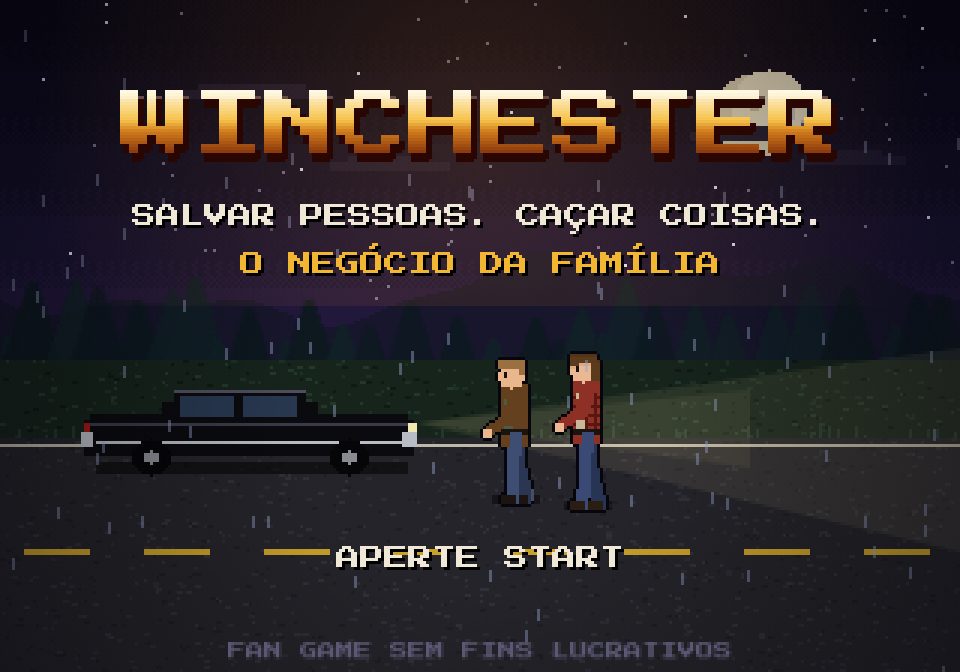

# WINCHESTER: O Negócio da Família

Fan game beat 'em up em pixel art, no estilo Golden Axe / Mega Drive, inspirado na série Supernatural. Roda direto no navegador, no computador e no celular.

**▶ Jogar:** [winchester-mu.vercel.app](https://winchester-mu.vercel.app/). Também aparece nos projetos do [portfólio do autor](https://github.com/Gabrielsvdata/Portfolio).



> Projeto acadêmico e sem fins lucrativos. Personagens inspirados em *Supernatural*, de Eric Kripke. Sem relação oficial com a série ou com seus donos.

## O jogo

1. **Tela inicial:** o Impala na estrada à noite, com chuva, relâmpagos e o logo piscando como luz com mau contato.
2. **Abertura "A estrada até aqui":** 6 cenas animadas contam a origem dos Winchester: o incêndio de 1983 em Lawrence, os olhos amarelos, a vida na estrada, Stanford e a pista de Jericho.
3. **4 capítulos**, cada um com história antes e depois, escolha de caçador, fase própria e chefe:

| Capítulo | Lugar | Inimigos | Chefe | Caçadores |
|---|---|---|---|---|
| 1. A Mulher de Branco | Jericho, Califórnia: estrada na mata, ponte e a casa da Constance | Espíritos | A Mulher de Branco | Dean, Sam |
| 2. Sangue de Morto | Manning, Colorado: fazenda e celeiro do ninho | Vampiros | Luther, o líder do ninho | + John |
| 3. Olhos Negros | Ferro-velho do Bobby, Dakota do Sul | Demônios e vampiros | Meg | + Bobby, Castiel |
| 4. O Portão do Diabo | Cemitério em Wyoming | Demônios, vampiros e espíritos | Azazel, o demônio de olhos amarelos | Todos, com o John como espírito |

Na transição entre capítulos, a história continua e cada personagem novo é apresentado com o motivo de entrar na equipe: John reaparece em Manning atrás do Colt, Bobby abre o ferro-velho, Castiel chega como anjo, e no capítulo final o espírito de John escapa do Portão do Diabo. A escolha do caçador acontece na mesma tela, com os novos marcados como **NOVO**.

O progresso fica salvo no navegador, e a opção **Capítulos** do menu libera os capítulos já alcançados.

### Mecânicas

| Mecânica | Como funciona |
|---|---|
| Combo | 3 golpes; o terceiro derruba |
| Voadora | Ataque durante o pulo |
| Corrida e ombrada | Toque duas vezes para o lado e ataque |
| Tiro | Cada caçador tem o seu, com recarga (tabela abaixo) |
| Magia | Usa os sacos de sal juntados (até 4). Quanto mais sacos, mais forte |
| Fraquezas | Sal e ferro contra espíritos, lâminas contra vampiros, água benta e lâmina angelical contra demônios |
| O Colt | No capítulo 4, os golpes só quebram o controle do Azazel. Quando a barra zera, o espírito do John segura o demônio (ou o da Mary, se você estiver jogando com o John) e o TIRO vira o tiro do Colt |
| Itens | Sacos de sal, torta e hambúrguer, que saem das latas de lixo e dos inimigos |
| Vidas | 3 vidas e tela de "Continuar?" com contagem regressiva |

### Caçadores

| Caçador | Arma | Tiro | Magia |
|---|---|---|---|
| Dean | Pé de cabra de ferro | Espingarda de sal grosso | Círculo de sal derramado no chão |
| Sam | Atiçador de ferro | Pistola com bala de ferro | Onda psíquica |
| John | Facão | Rifle que atravessa vários inimigos | Facão giratório |
| Bobby | Chave de roda | Frascos de água benta, que explodem em área | Armadilha do Diabo: prende demônios e atrasa o resto |
| Castiel | Lâmina angelical | Teletransporte com asas para as costas do inimigo | Punição divina: luz na tela toda, que também cura |

### Inimigos

- **Espíritos das vítimas:** somem com efeito de falha na imagem e reaparecem atrás do jogador.
- **Espíritos que gritam:** atacam de longe com ondas de som que precisam ser puladas.
- **Vampiros:** caem do teto do celeiro, dão bote em linha reta e regeneram.
- **Demônios de olhos negros:** saem da fumaça, lutam de perto e arremessam fumaça negra de longe.
- **A Mulher de Branco:** investida, grito duplo, teletransporte e invocação de vítimas.
- **Luther:** botes em sequência e chamada de reforços do ninho.
- **Meg:** arremesso triplo de fumaça, teletransporte e reforços do inferno.
- **Azazel:** telecinese marcada por um círculo amarelo no chão, fogo amarelo em três linhas, teletransporte e o desafio do Colt.

## Controles

| Ação | Teclado | Celular | Gamepad |
|---|---|---|---|
| Mover | Setas ou WASD | Analógico | Analógico ou direcional |
| Atacar | J ou Z | ATACAR | X |
| Pular | K, X ou Espaço | PULO | A |
| Tiro | L ou C | TIRO | B |
| Magia | I ou V | MAGIA | Y |
| Pausa | Esc ou P | Botão II | Start |

## Como foi feito

Tudo em um único arquivo HTML, sem engine, sem bibliotecas e sem imagens.

- **Gráficos:** HTML5 Canvas em 320×224, a resolução do Mega Drive, ampliado sem suavização. Os personagens são bonecos com esqueleto (quadril, joelhos, ombros, cotovelos) desenhados pixel a pixel a cada quadro, com contorno, rotação ao cair e efeito de falha nos fantasmas.
- **Cenário:** 4 fases com camadas de parallax geradas por código: estrada e ponte de Jericho, fazenda e celeiro sob lua vermelha, pilhas de carros do ferro-velho e o cemitério com o Portão do Diabo.
- **Combate:** máquina de estados por personagem, caixas de acerto com profundidade (eixo y) e altura (eixo z), pausa no impacto, quique ao cair e um sistema que limita quantos inimigos atacam ao mesmo tempo.
- **Áudio:** Web Audio API. Efeitos e música da fase são sintetizados em tempo real, com onda de pulso no estilo NES e Mega Drive. A introdução da tela inicial (`audio/abertura.mp3`) é uma progressão de acordes arranjada no estilo YM2612: guitarras FM com saturação, órgão por síntese aditiva, baixo com estalo e bateria no estilo do canal DAC.
- **Entrada:** teclado, toque (analógico e botões) e Gamepad API.
- **Textos:** a fonte de pixel não tem maiúsculas acentuadas, então os acentos são desenhados à mão por cima das letras.

## Arquivos

```
winchester/
├── index.html        # o jogo inteiro (HTML, CSS e JavaScript)
├── audio/
│   ├── abertura.mp3  # introdução da tela inicial
│   └── LEIA-ME.txt
├── winchester.png    # captura da tela inicial
└── README.md
```

## Rodar localmente

Não precisa instalar nada. Sirva a pasta com qualquer servidor estático:

```bash
npx serve .
# ou
python3 -m http.server 8000
```

Abra o endereço mostrado no terminal. O `index.html` também abre direto no navegador, mas aí a introdução em MP3 não carrega e o jogo usa a trilha sintetizada.

## Deploy na Vercel

1. Em [vercel.com](https://vercel.com), clique em **Add New → Project** e importe este repositório.
2. Em **Framework Preset**, deixe **Other**. Não há comando de build: a Vercel publica os arquivos como estão.
3. Clique em **Deploy**. Cada push na `main` publica uma nova versão.

## Próximos passos

- Fase de estrada com o Impala como montaria.
- Modo para dois jogadores.

## Autor

**Gabriel Silvano** · [GitHub](https://github.com/Gabrielsvdata) · [LinkedIn](https://linkedin.com/in/gabriel-silvano-vieira)
